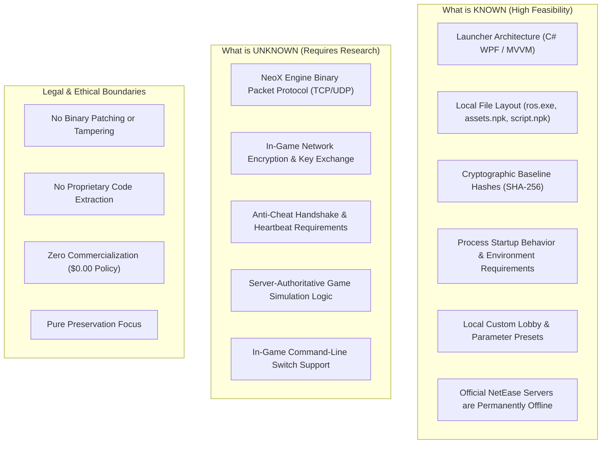

# ROS REVIVAL — Backend Feasibility & Compatibility Assessment

## 1. Executive Summary

This assessment evaluates the technical, operational, and legal feasibility of building an independent backend for the **ROS REVIVAL PC Preservation Project**.

The primary objective is to define what can be reliably achieved today, what remains unknown, what requires authorized documentation, and how the community can proceed while strictly preserving original game files and maintaining a **$0.00 budget**.

---

## 2. Technical Fact Base: What is Known vs. Unknown

### 2.1 What is KNOWN
1. **Launcher & Presentation Layer**:
   - The native C# WPF launcher reliably starts, detects game installations, validates asset integrity, manages guest profiles, and coordinates custom lobbies with unique 6-digit room IDs.
   - All launcher operations run locally with atomic JSON file persistence and zero network dependency.
2. **Game Binary & Asset Architecture**:
   - The game client executable is `ros.exe` (PE32+ x86-64 executable built on NetEase's NeoX engine).
   - Core game content resides in `assets.npk` (compiled 3D models, textures, sounds) and `script.npk` (compiled Python / game scripts).
   - The game requires an interactive desktop session (Session 1) with genuine DirectX 3D hardware acceleration.
3. **Decommissioned Infrastructure**:
   - All official NetEase master servers, login gateways, and battle royale game servers were permanently decommissioned in 2022.
   - Attempting to launch the original game without server emulation leaves the client at the title screen or offline error state.

### 2.2 What is UNKNOWN
1. **Network Packet Protocol**:
   - The exact binary framing, serialization format (Protobuf, MessagePack, or custom binary structs), and compression algorithms used by the NeoX network layer have not been publicly documented.
2. **Encryption & Key Exchange**:
   - Client-server handshakes typically use TLS, RSA key exchanges, or symmetric session keys (AES). Decrypting or synthesizing these sessions without authorized technical documentation or clean protocol captures is non-trivial.
3. **Anti-Cheat Heartbeat Constraints**:
   - Rules of Survival utilized anti-cheat mechanisms. It is unknown whether the game client will abort execution if it fails to receive signed periodic heartbeats from a trusted server.
4. **Dedicated Server Simulation Code**:
   - Battle Royale matches (100-player circle contraction, vehicle physics, ballistics, item spawns) were server-authoritative. NetEase never publicly released a standalone server binary for Rules of Survival PC.

---

## 3. Legal, Ethical, and Safety Boundaries

To protect the community, contributors, and the integrity of this preservation initiative, all backend planning strictly enforces these guardrails:

> [!IMPORTANT]
> **Strict Preservation Guardrails**:
> 1. **Zero Binary Modification**: Original game binaries (`ros.exe`) and game archives (`assets.npk`, `script.npk`) must remain 100% read-only and unpatched.
> 2. **No Anti-Cheat Driver Tampering**: We do not crack, reverse-engineer, or circumvent anti-cheat drivers.
> 3. **No Stolen or Leaked Code**: The backend must be created entirely clean-room from public RFC standards. Zero proprietary NetEase source code or leaked server binaries will be hosted or utilized.
> 4. **Zero-Budget & Non-Commercial**: $0.00 lifetime budget. No paid subscriptions, microtransactions, or cloud hosting charges.

---

## 4. Feasibility Classification Matrix

| Subsystem | Feasibility | Risk Level | Required Prerequisites | Recommended Next Step |
| :--- | :---: | :---: | :--- | :--- |
| **Launcher Community Backend (REST/SignalR)** | **HIGH (100%)** | Very Low | None. Standard C# / ASP.NET Core stack. | Implement proposed `ROS.Revival.MockBackend`. |
| **Authentication & Profile Synchronization** | **HIGH (100%)** | Very Low | None. Stateless JWT with Guest IDs. | Include in Mock Backend. |
| **Multiplayer Custom Lobby Rooms** | **HIGH (100%)** | Very Low | None. 6-digit room routing over WebSockets. | Include in Mock Backend. |
| **Matchmaking & Queues** | **HIGH (95%)** | Low | Sufficient player pool or mock bot pools. | Ticket-based queue engine. |
| **Local Mock Match Server Stub** | **HIGH (90%)** | Low | TCP/UDP socket listener on localhost. | Verify client socket connectivity. |
| **In-Game Network Handshake Emulation** | **MEDIUM (40%)** | High | Network packet inspection or authorized docs. | Controlled network telemetry analysis. |
| **Full 100-Player Battle Royale Server** | **LOW (20%)** | Critical | Complete authoritative physics engine or original server source code. | Deferred to long-term community research. |

---

## 5. Risk Mitigation & Recommendations

### Recommended Staged Strategy:

1. **Stage 1 (Immediate — Milestone 4)**:
   - Build a **Local Mock Backend** (`ROS.Revival.MockBackend`) implementing the full REST and SignalR API specification.
   - Test launcher-to-backend communication, room creation, multi-client lobby updates, and mode capacity changes on `localhost:5000` with zero cost.
   - Maintain Test 1 status as `TEST_BLOCKED` until physical Windows GPU execution is confirmed.

2. **Stage 2 (Mid-Term — Milestone 5)**:
   - Conduct controlled, harmless network observation on the Windows GPU runner to observe what socket connections `ros.exe` attempts on startup (e.g. DNS lookups, TCP ports).
   - Document connection targets without modifying client binaries.

3. **Stage 3 (Long-Term Community Collaboration)**:
   - Seek authorized technical documentation or community preservation partnerships.
   - Implement clean-room network gateway emulation for offline / LAN exploration if technically and legally verified.
