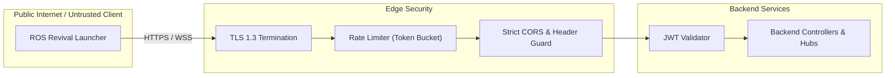

# ROS REVIVAL — Backend Architecture & Service Specification

## 1. Executive Summary

Milestone 4 establishes the architectural blueprint for an independent, community-driven backend for the **ROS REVIVAL PC Preservation Project**.

Because official NetEase Rules of Survival servers were decommissioned, an independent backend is necessary to support multiplayer lobby coordination, match preparation, community player identities, and server orchestration.

This specification adheres to our core non-negotiable principles:
1. **Zero Proprietary Code**: Built from scratch using standard open-source protocols (HTTP/REST, WebSockets, SignalR).
2. **Zero Game File Modification**: The original `ros.exe`, `assets.npk`, and `script.npk` remain untouched and read-only.
3. **Zero-Budget Strategy**: Architected for $0.00 development and deployment using developer loopback hosting, free-tier container services, or community-donated hardware.
4. **Clean Abstraction**: The backend separates launcher-side room coordination from actual 3D dedicated game server simulation.

---

## 2. High-Level System Architecture

```mermaid
flowchart TD
    subgraph ClientLayer["Client Layer"]
        Launcher["ROS Revival Desktop Launcher (WPF / C#)"]
        GameClient["Original ros.exe (Preserved Client)"]
    end

    subgraph BackendLayer["Independent Backend (ROS.Revival.Backend)"]
        APIGateway["REST API & WebSocket Gateway"]
        AuthService["Authentication & Identity Service"]
        LobbyService["Lobby & Room Management Service"]
        MatchService["Matchmaking & Queue Service"]
        SessionService["Game Session & Host Orchestrator"]
        ConfigService["Config & Manifest Service"]
    end

    subgraph DataLayer["Persistence & State Layer"]
        StateCache["In-Memory State / Redis (Ephemeral Rooms)"]
        Database["Relational DB (SQLite / PostgreSQL)"]
    end

    subgraph DedicatedServerLayer["Game Server Infrastructure"]
        MockServer["Local Mock Match Server (Verification)"]
        DedicatedHost["Future Authoritative Dedicated Server"]
    end

    Launcher -->|REST / HTTPS| APIGateway
    Launcher -->|WebSocket / SignalR| APIGateway

    APIGateway --> AuthService
    APIGateway --> LobbyService
    APIGateway --> MatchService
    APIGateway --> SessionService
    APIGateway --> ConfigService

    AuthService --> Database
    LobbyService --> StateCache
    MatchService --> StateCache
    SessionService --> DedicatedHost
    SessionService --> MockServer

    Launcher -.->|Process Launch (Clean Parameters)| GameClient
    GameClient -.->|Future Simulated Net Protocol| DedicatedHost
```

---

## 3. Subsystem Responsibilities

### 3.1 Authentication & Identity Service
- **Purpose**: Manage player identities while preserving the 100% offline Guest mode.
- **Responsibilities**:
  - **Guest Token Issuance**: Issue short-lived, signed JSON Web Tokens (JWT) using local UUIDs and guest nicknames.
  - **Stateless Verification**: Tokens contain cryptographically verified claims (`sub`, `nickname`, `role`, `exp`) signed with HMAC-SHA256 or Ed25519.
  - **Optional Community Accounts**: Support optional passwordless email links or token credentials (passwords hashed using Argon2id).
  - **Zero Telemetry Tracking**: Zero personal data collection, zero third-party tracking scripts.

### 3.2 Lobby & Room Management Service
- **Purpose**: Coordinate multiplayer room lobbies, team formations, and match parameter agreements.
- **Responsibilities**:
  - **6-Digit Room ID Allocation**: Generate collision-free numeric room codes (`100000`–`999999`) for simple player sharing.
  - **Room Lifecycle Management**: Transitions room through states:
    `CREATED` ➔ `WAITING` ➔ `PREPARING` ➔ `READY` ➔ `ALLOCATING_SERVER` ➔ `IN_MATCH` ➔ `TERMINATED`.
  - **Role & Slot Management**: Support Host, Member, and visual placeholder Bot slots.
  - **Capacity Safeguards**: Enforce team mode capacities:
    - Solo: 1 player
    - Duo: 2 players
    - Squad: 4 players
    - Fireteam: 5 players
    - Custom Tournament: Up to 100 players
  - **Real-Time State Synchronization**: Broadcast room modifications (member join/leave, ready toggle, map selection) via WebSockets / SignalR.

### 3.3 Matchmaking & Queue Engine
- **Purpose**: Match individual players or pre-formed squads into balanced matches.
- **Responsibilities**:
  - **Ticket-Based Queues**: Distinct queues categorized by:
    - Map: *Ghillie Island* (6.4km) vs. *Fearless Fiord* (8.0km).
    - Mode: *Solo*, *Duo*, *Squad*, *Fireteam*.
    - Perspective: *TPP* (Third-Person) vs. *FPP* (First-Person).
  - **Grouping Logic**: Assemble squads into full game pools (e.g. 60–100 players per match).
  - **Timeouts & Expansion**: If insufficient human players exist, expand pool parameters or offer simulated match testing.

### 3.4 Game Session & Dedicated Server Orchestrator
- **Purpose**: Allocate, monitor, and clean up match instances.
- **Responsibilities**:
  - **Session Allocation**: Provision server instances upon match readiness.
  - **Connection Token Distribution**: Provide launcher with connection details (IP address, port, one-time join token).
  - **Server Health Heartbeats**: Monitor running instances; detect crashed or hung processes.
  - **Match Completion Ingestion**: Ingest match duration, placements, and completion metrics.

### 3.5 Configuration & Integrity Manifest Service
- **Purpose**: Distribute launcher configuration, status notices, and asset integrity hashes.
- **Responsibilities**:
  - **Client File Validation**: Distribute SHA-256 hash manifests for `ros.exe`, `assets.npk`, `script.npk`, and `setting.ini`.
  - **Server Status Notices**: Inform launchers of maintenance windows or network state.
  - **Community Announcements**: Deliver non-intrusive community update feeds.

---

## 4. Technology Stack & Zero-Cost Architecture

To adhere to our **$0.00 budget**, the architecture leverages lightweight, highly optimized open-source components that run locally or on permanent free-tier cloud resources.

| Layer | Recommended Technology | Justification | Free-Tier / Zero-Cost Deployment |
| :--- | :--- | :--- | :--- |
| **API Runtime** | **ASP.NET Core 8.0 / 10.0** Minimal APIs | Same technology stack as WPF Launcher; shared models (`LobbyRoom`, `LobbySlot`); sub-millisecond throughput; negligible memory footprint (<50MB). | Run locally (`localhost:5000`) or deploy as Linux container. |
| **Real-Time Hub** | **ASP.NET Core SignalR** | Built-in WebSocket handling, automated reconnection, room/group broadcasting, fallback to Server-Sent Events. | Integrated inside ASP.NET Core process. |
| **Database** | **SQLite (Dev) / PostgreSQL (Prod)** | SQLite provides zero-cost zero-config embedded persistence. PostgreSQL handles concurrent writes. | Embedded SQLite file or Supabase / Render free tier. |
| **State Cache** | **MemoryCache (Dev) / Dragonfly/Redis** | Ultra-fast in-memory room state tracking and TTL expiration. | In-process memory (0 cost) or free-tier Upstash Redis. |
| **Testing Harness** | **Docker Compose** | One-command local spin-up for reproducible testing. | 100% Free local execution. |

### Zero-Cost Cloud Hosting Options (No Payment Cards Required)

1. **Local Developer & Community Host ($0.00)**:
   - Run the backend service on the local machine (`localhost:5000`).
   - Use port forwarding or Cloudflare Tunnels (Zero Trust Free) for remote peer testing.
2. **Oracle Cloud Free Tier ($0.00 Forever)**:
   - 4 Ampere ARM compute cores, 24 GB RAM, 200 GB storage free forever without trial expiration.
   - Capable of running both the REST/WebSocket backend and multiple lightweight server containers.
3. **Render / Fly.io Free Tiers ($0.00)**:
   - Free container hosting for low-volume API testing.

---

## 5. Security Architecture & Threat Model



### Key Security Guardrails:
1. **Input Sanitization**: Room IDs must match regex `^\d{6}$`. Nicknames strictly alphanumeric, max 24 chars.
2. **Replay & Impersonation Protection**: All API mutations require `Authorization: Bearer <JWT>`. Room actions check that caller identity matches slot host or member.
3. **Capacity Protection**: Mode downsizing validates slot occupancy before removal.
4. **No Injected Secrets**: Zero hardcoded passwords, tokens, or encryption keys in source repositories.
5. **Rate Limiting**: 60 requests/minute per IP on auth endpoints; 120/minute on lobby endpoints to prevent DoS.

---

## 6. Proposed Local Mock Backend Design

To allow thorough verification of launcher networking without requiring public cloud resources or interfering with `ros.exe`, we propose a lightweight standalone mock service:

- **Project Name:** `ROS.Revival.MockBackend`
- **Deployment:** Single executable console app (`ROS.Revival.MockBackend.exe`) or `dotnet run`.
- **Port:** `http://127.0.0.1:5000`
- **Features:**
  - Implements the complete REST & SignalR API specification.
  - In-memory room store with automatic 6-digit room allocation.
  - Mock game session generator returning test loopback connection details.
  - Simulated network latency toggles (0ms, 50ms, 250ms) for UI resilience testing.
  - Visual terminal logging displaying all incoming requests and broadcasts.
